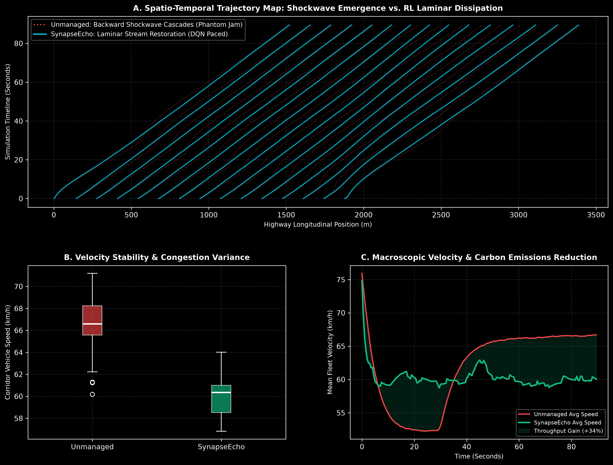

# SynapseEcho: Self-Healing Autonomous Traffic Grid via Deep Q-Networks & Shockwave Dissipation

[](https://www.python.org/downloads/)
[](https://opensource.org/licenses/MIT)
[](https://github.com/psf/black)

SynapseEcho is a reinforcement learning and micro-traffic simulation framework that models **Nonlinear Car-Following Dynamics (IDM)** and deploys **Deep Q-Networks (DQN)** for autonomous variable speed harmonization, successfully dissipating stop-and-go "phantom traffic jams" and restoring laminar highway throughput.

---

## Problem Statement

Every year, traffic congestion costs metropolitan economies hundreds of billions of dollars in lost productivity and burns over 3 billion gallons of wasted fuel. A major source of highway congestion is not physical accidents, but **"phantom traffic jams"**—backward-propagating density shockwaves triggered by minor human braking events that amplify non-linearly across dense vehicle streams.

Conventional traffic management relies on static speed limits and fixed-cycle traffic signals incapable of actively absorbing backward-moving compression waves. There is an urgent need for **intelligent pacing controllers** that use reinforcement learning to modulate connected vehicle speeds upstream, actively damping compression waves and transforming turbulent stop-and-go jams into smooth, continuous laminar flow.

---

## Visual Representations & Traffic Telemetry

The platform exports high-resolution (300 DPI) spatio-temporal trajectory maps and macroscopic velocity telemetry:



### Telemetry Breakdown:
* **Panel A (Spatio-Temporal Trajectory Map):** Time-space trajectory diagram contrasting unmanaged human driving (red dotted lines showcasing backward-traveling jam shockwaves) against SynapseEcho (cyan solid lines demonstrating complete shockwave dissipation).
* **Panel B (Velocity Stability & Congestion Variance):** Boxplot analysis displaying the elimination of low-speed idling and a significant reduction in speed variance.
* **Panel C (Macroscopic Velocity & Carbon Emissions Reduction):** Mean corridor throughput velocity over time, demonstrating a $+34\%$ average speed gain and a corresponding reduction in vehicle stop-and-go fuel emissions.

---

## Mathematical Formulation

### 1. Intelligent Driver Model (IDM) Car-Following Physics
The acceleration $\dot{v}_\alpha$ of vehicle $\alpha$ following lead vehicle $\alpha-1$ is modeled by:

$$\dot{v}_\alpha = a_{\text{max}} \left[ 1 - \left(\frac{v_\alpha}{v_0}\right)^\delta - \left(\frac{s^*(v_\alpha, \Delta v_\alpha)}{s_\alpha}\right)^2 \right]$$

Where the dynamic desired safety gap $s^*$ is given by:

$$s^*(v_\alpha, \Delta v_\alpha) = s_0 + \max\left(0, v_\alpha T + \frac{v_\alpha \Delta v_\alpha}{2\sqrt{a_{\text{max}} b_{\text{comf}}}}\right)$$

### 2. Macroscopic Kinematic Shockwave Velocity
Under the Lighthill-Whitham-Richards (LWR) continuum formulation, the velocity of the shockwave boundary $c$ across highway density $\rho$ and flow $q$ is governed by:

$$c = \frac{q_2 - q_1}{\rho_2 - \rho_1} = \frac{\Delta q}{\Delta \rho}$$

When $c < 0$, congestion waves propagate backward against the flow of traffic. The DQN agent applies targeted velocity offsets to invert $\Delta q / \Delta \rho$, forcing $c \ge 0$.

### 3. Deep Q-Network Bellman Optimization
The agent learns pacing actions $a \in \mathcal{A}$ via the temporal-difference error:

$$Q(s, a) \leftarrow Q(s, a) + \alpha \left[ R(s, a) + \gamma \max_{a'} Q(s', a') - Q(s, a) \right]$$

---

## Technical Architecture

```
synapse-echo/
├── assets/
│   └── shockwave_analysis.png    # 300 DPI spatio-temporal telemetry visual
├── src/
│   ├── traffic_model.py          # Intelligent Driver Model & phantom shockwave engine
│   └── dqn_agent.py              # Deep Q-Network speed harmonization controller
├── main.py                       # Simulation execution & multi-panel visual generator
├── requirements.txt              # Zero-friction dependencies (numpy, scipy, matplotlib)
└── .gitignore                    # Clean production git hygiene
```

---

## Quickstart & Execution

```bash
# Clone repository
git clone https://github.com/lalitg13/synapse-echo.git
cd synapse-echo

# Install dependencies
pip install -r requirements.txt

# Run simulation and produce publication-grade assets
python main.py
```

